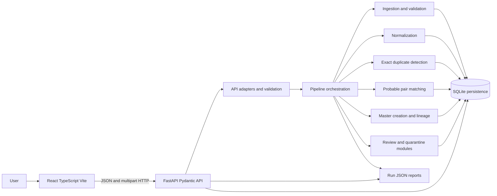
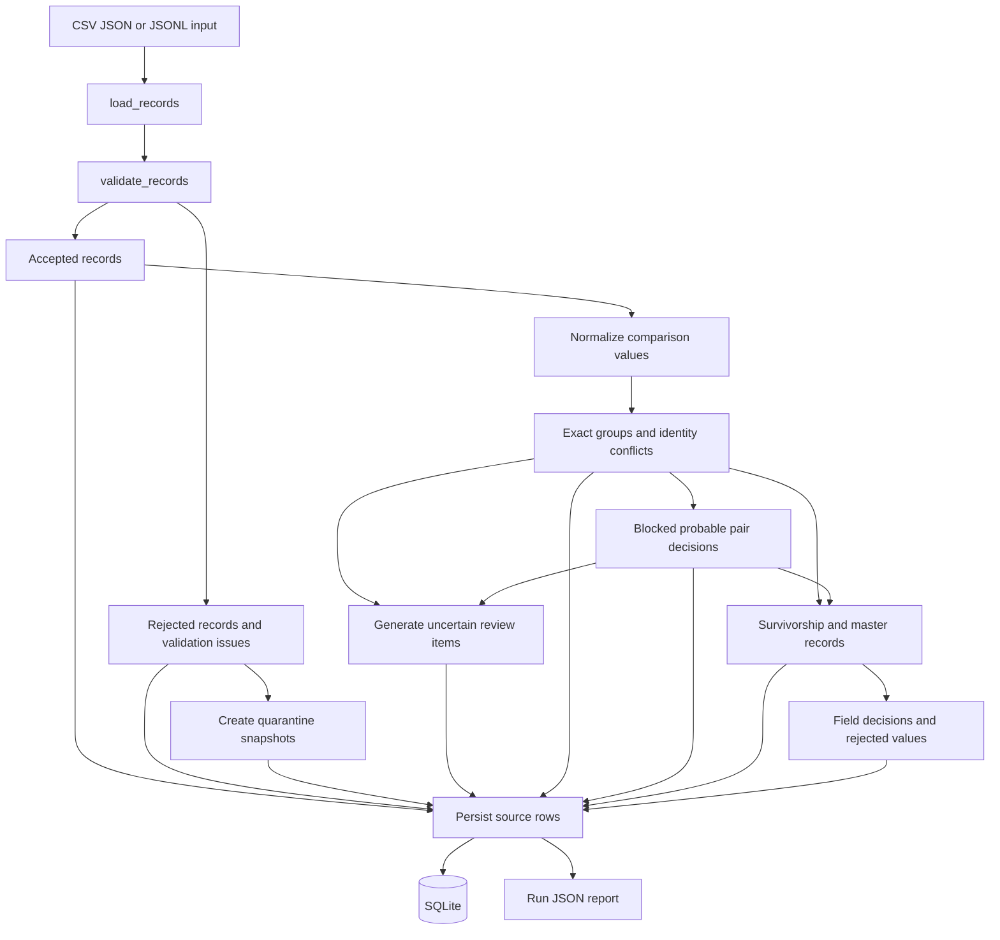

# MergeMind AI Architecture

## System Overview

MergeMind AI separates the browser presentation layer, HTTP adapter, Python data-processing modules, persistence, and report artifacts. The browser never connects to SQLite and does not implement matching or survivorship rules.

## Components

### React frontend

The frontend is in `frontend/`. `src/App.tsx` provides browser-history navigation, the dark workspace sidebar, global search, and route selection. `src/pages/DashboardPage.tsx` renders database-backed summary data. `src/pages/WorkflowPages.tsx` contains ingestion, duplicate exploration, review, quarantine, master, lineage, pipeline-run, and report views. `src/services/apiClient.ts` centralizes JSON requests, multipart upload, HTTP error handling, and URL construction; `dashboardApi.ts` defines the dashboard API response contract.

The development server in `frontend/vite.config.ts` proxies `/api` to `VITE_API_PROXY_TARGET`, defaulting to `http://127.0.0.1:8000`. `VITE_API_BASE_URL` can be used when a direct base URL is needed.

### FastAPI service

`src/api/app.py` defines the versioned HTTP routes and Pydantic input/output models in `src/api/models.py`. `src/api/workflows.py` adapts existing database retrieval functions and parameterized read queries for pagination and search. `src/api/repository.py` calculates dashboard aggregates through a read-only SQLite connection. `src/api/uploads.py` applies upload limits, generated staging names, supported file extensions, ingestion, and validation before pipeline execution.

At application startup, `src/api/migrations.py` calls the backend `initialize_database()` only when the configured database file already exists. This uses the existing additive schema setup: missing current tables are created and `input_fingerprint` is added if absent. Existing records are not deleted. Persistence helpers may also call the backend's schema initializer as part of their normal contracts.

### Python processing modules

- `src/ingestion.py`: reads CSV, JSON arrays, JSON Lines, and NDJSON and records source provenance.
- `src/validation.py`: validates source records against `src/schemas.py`, produces accepted/rejected collections and schema-drift details.
- `src/normalization.py`: creates comparison values separately from original source fields.
- `src/duplicate_detection.py`: applies entity-specific exact rules and reports exact groups, pairs, and identity conflicts.
- `src/probable_matching.py`: blocks candidate pairs, calculates RapidFuzz similarities and weighted confidence, and classifies pairs.
- `src/survivorship.py`: creates deterministic masters and field-level provenance from exact groups and safe isolated strong-probable pairs.
- `src/review_queue.py`: generates uncertain candidates and delegates audited status transitions to persistence.
- `src/quarantine.py`: snapshots validator-rejected source rows and delegates audited disposition changes.
- `src/pipeline.py`: coordinates stages, persists artifacts, builds run metrics, recovers same-input failed runs, and writes reports.
- `src/database.py`: owns SQLite schema setup, parameterized persistence/retrieval helpers, transactions, foreign keys, and additive fingerprint-column compatibility.

### SQLite and reports

The default database is `data/output/mergemind.db`; the API can override it with `MERGEMIND_DATABASE_PATH`, and the CLI accepts `--database`. The current schema contains `pipeline_runs`, `source_records`, `duplicate_pairs`, `master_records`, `field_lineage`, `pipeline_errors`, `review_items`, `review_history`, `quarantine_records`, and `quarantine_history`.

JSON reports are separate filesystem artifacts under `reports/` by default, configurable with `MERGEMIND_REPORT_DIRECTORY` in the API or `--report-directory` in the CLI. They are read through validated run IDs by the API; local paths are removed/redacted from responses.

## Data Flow

## Interaction and Ownership

1. The frontend submits files and actions to FastAPI; all service responses are JSON except multipart request bodies.
2. FastAPI validates request shape, file extension/size, identifiers, and bounded pagination parameters.
3. API adapters call the existing pipeline, review, quarantine, or database functions. They do not reimplement matching or survivorship.
4. Python modules keep original source data and derived comparison values distinct.
5. SQLite stores run-scoped rows and audit histories; the pipeline writes report files after execution.
6. The frontend refreshes affected pages after successful write actions. A review acceptance does not recompute masters; quarantine resolution does not reprocess a record.

## Operational Constraints

- Pipeline execution over HTTP is synchronous and serialized by a process-local lock; there is no durable job queue or progress polling API.
- Staged upload metadata is process-local, and staged files expire after two hours. Multi-worker deployment needs shared upload/session storage.
- HTTP runs are tied to an idempotency-derived default run ID, but there is no separate persisted idempotency-response cache.
- Probable matching materializes candidate pairs in memory; see [PERFORMANCE_BENCHMARK.md](PERFORMANCE_BENCHMARK.md).
