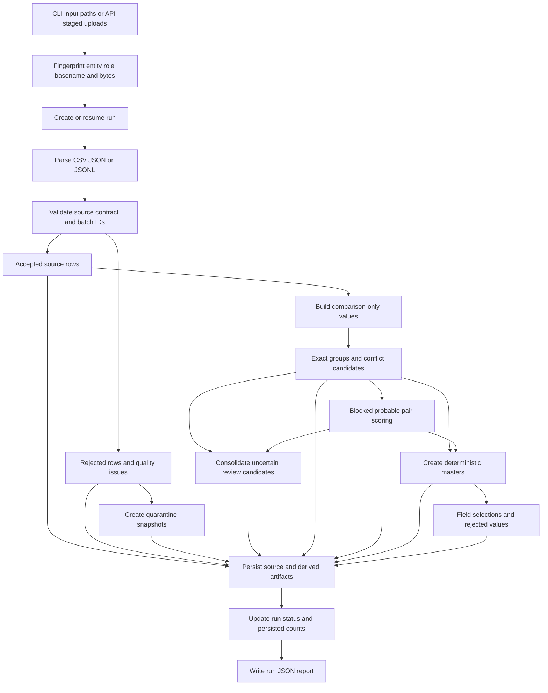

# Pipeline Workflow

The production pipeline is orchestrated by `src/pipeline.py`. Matching and survivorship decisions remain in their owning modules; the orchestrator orders work, records metrics, persists artifacts, and writes the execution report.

## Stages

1. **Data ingestion.** `src/ingestion.py::load_records` reads CSV, JSON arrays, JSON Lines, and NDJSON. It attaches entity, source basename, one-based row/record number, source format, and ingestion timestamp. It does not validate business fields. CSV values remain strings; JSON values keep decoded JSON types.
2. **Validation.** `src/validation.py::validate_records` checks required fields, basic customer email/phone forms, timestamp syntax, finite nonnegative product price, duplicate entity primary keys within the batch, and unexpected-field schema drift. Unexpected fields are accepted by default and reported; strict mode can reject them. Valid and rejected records are separated, and all issues are retained.
3. **Quarantine.** `src/quarantine.py::create_quarantine_entries` snapshots each validation-rejected source row, its source provenance, and every validation issue. It does not validate again. Entries begin in `QUARANTINED`.
4. **Normalization.** `src/normalization.py` creates separate comparison fields. Text is Unicode NFC-normalized, trimmed, whitespace-collapsed, and casefolded. Phone formatting is removed only for recognized common separators; ambiguous values are retained as normalized text. Original fields are preserved.
5. **Exact duplicate detection.** `src/duplicate_detection.py` applies entity-specific deterministic rules. Customer groups require matching normalized email, phone, and name; shared identifiers with contradictory values become conflict candidates. Product groups are based on SKU, product name, and compatible brand; contradictory identity evidence is surfaced for review.
6. **Probable matching.** `src/probable_matching.py` creates candidate pairs through configured blocking, excludes records already in exact groups, computes similarity and weighted confidence, and classifies each pair as `STRONG_PROBABLE_MATCH`, `REVIEW_REQUIRED`, or `NO_MATCH`. It outputs pair decisions; it does not build transitive clusters.
7. **Survivorship.** `src/survivorship.py` treats exact groups as confirmed. It merges a strong-probable edge only when it is an isolated pair of otherwise ungrouped records. Edges touching existing groups or sharing records with other strong edges remain unresolved. Review-required and no-match edges never merge.
8. **Master record generation.** Every safe merged group and every otherwise ungrouped accepted record produces a deterministic master. Master IDs derive from entity and sorted contributing source IDs. Merge methods are `EXACT`, `STRONG_PROBABLE`, and `SINGLETON`.
9. **Data lineage.** Every master field records selected value, selected source ID/system, selection rule, and rejected conflicting assertions. Empty optional fields use `no_non_empty_value`. Ambiguous timezone recency is recorded rather than guessed. Product conflicting SKUs are left unselected and reported as unresolved conflicts.
10. **Review queue.** `src/review_queue.py::generate_review_items` consolidates probable review-required pairs, exact identity conflicts, and unsafe probable connections. Exact pairs, already merged pairs, and no-match pairs are excluded. Review actions append audit history. Accepting a review does not modify masters.
11. **SQLite persistence.** `src/database.py` writes run-scoped sources, duplicate decisions/evidence, masters, lineage, review/quarantine records and histories, and operational errors. Public write operations are transactional and use natural-key upserts. Replacing a run deletes only that run and cascades its artifacts. Validation findings remain separate from operational error rows.
12. **Reporting and logging.** `PipelineResult` includes stage order, per-stage input/output/reject counts, status/duration, per-entity metrics, quality issues, operational errors, unresolved conflicts, review/quarantine totals, persistence counts, throughput, and execution summary. A JSON report is written as `reports/<run_id>_report.json`. Structured logging emits JSON Lines without source field values or exception messages.

## Failure, Resume, and Replacement

- A failed run is marked `FAILED` when its database is reachable and receives a report when reporting succeeds.
- Repeating the same run ID with the same fingerprint resumes/upserts the run; existing review/quarantine decisions and histories are not reset.
- A fingerprint mismatch is rejected before the existing run or report is changed. Use a new run ID or `--replace-existing` to intentionally rebuild only the named run.
- A rejected record is retained as a rejected source row and a quarantine item. Resolving/discarding quarantine is an auditable disposition, not data correction or retry.
- Report generations in old checked-in files may predate current field names; consumers should treat missing report sections as unavailable rather than infer zero.
