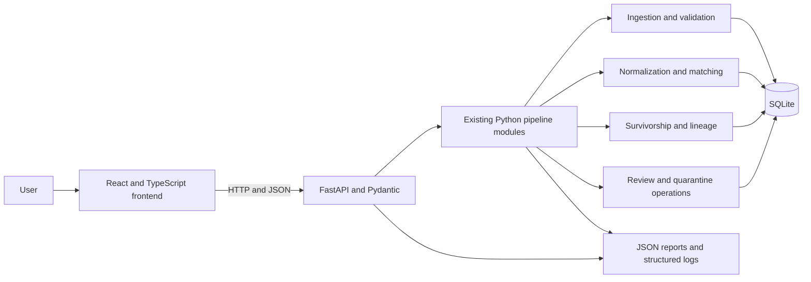

# MergeMind AI

**Resolve entities. Improve data quality. Preserve every decision.**

MergeMind AI is a local-first entity-resolution and data-quality application for customer and product records. It ingests source files, validates and normalizes records, identifies exact duplicates and probable pairs, creates survivorship-based master records, and retains field-level lineage, review history, quarantine history, and execution reports.

> **Evaluation note:** the 10K customer benchmark completed. The 10K product and both 100K attempts hit the configured memory guard; 100K end-to-end processing is not demonstrated. See [PERFORMANCE_BENCHMARK.md](PERFORMANCE_BENCHMARK.md).

## Problem

Organizations often hold multiple inconsistent versions of the same customer or product across systems. Exact keys are incomplete, near-duplicate values need context, and silent merges can destroy trust. Teams need a repeatable way to find likely relationships while keeping source values, uncertainty, and human decisions auditable.

## Solution

MergeMind AI combines deterministic exact rules with RapidFuzz-based pair scoring and blocking. It keeps matching and survivorship decisions in Python, stores run-scoped artifacts in SQLite, exposes them through FastAPI, and provides a React workspace for upload, review, comparison, lineage, and reporting.

## Features

- CSV, JSON array, JSON Lines, and NDJSON ingestion for customers and products.
- Schema validation, rejection details, permissive schema-drift reporting, and quarantine entries.
- Conservative text normalization that retains original source fields.
- Entity-specific exact duplicate groups and identity-conflict candidates.
- Blocked probable-pair scoring with explicit strong, review-required, and no-match decisions.
- Deterministic survivorship masters, contributing source IDs, and field-level lineage.
- Audited review and quarantine status transitions; these actions do not automatically merge or reprocess records.
- Run-scoped SQLite persistence, input fingerprints, same-input resume, explicit per-run replacement, structured logs, and JSON execution reports.
- FastAPI endpoints and React pages for dashboard, ingestion, duplicate exploration, reviews, quarantine, masters, lineage, runs, and reports.

## Technology

- Python 3.10+, FastAPI, Pydantic, SQLite, pandas, RapidFuzz, pytest
- React, TypeScript, Vite, Tailwind CSS, Recharts, Lucide React, Radix UI primitives
- SQLite is accessed only by the Python service and backend modules; the browser never opens the database.

## Architecture



See [ARCHITECTURE.md](ARCHITECTURE.md) for module responsibilities and data flow.

## System Requirements

- Windows 10/11 or a compatible Python environment
- Python 3.10 or newer
- Node.js 18, 20, or 22+ and npm (matching the installed Vite 6 engine range)
- Several GiB of available RAM are recommended for larger runs. The measured 10K product case exceeded 1.25 GiB sampled RSS and stopped; the 100K end-to-end cases did not complete under the benchmark guard.

## Install on Windows

Run these commands from the repository root in PowerShell:

```powershell
py -3.10 -m venv .venv
.\.venv\Scripts\Activate.ps1
python -m pip install --upgrade pip
python -m pip install -r requirements.txt
```

If `py -3.10` is unavailable, create the environment with an installed Python 3.10+ executable. PowerShell may restrict activation scripts; in that case call `.venv\Scripts\python.exe` directly in the commands below.

Install frontend dependencies in a second terminal:

```powershell
cd frontend
npm.cmd install
```

## Run the Application

Start the API from the repository root:

```powershell
.\.venv\Scripts\python.exe -m uvicorn src.api.app:app --reload --host 127.0.0.1 --port 8000
```

The API startup applies the backend's additive schema setup to an existing configured database. It creates missing current tables and adds the nullable `input_fingerprint` column; it does not delete existing records. The default database is `data/output/mergemind.db`.

Start the frontend in another terminal:

```powershell
cd frontend
npm.cmd run dev
```

- Frontend: <http://127.0.0.1:5173/>
- Interactive API docs: <http://127.0.0.1:8000/docs>
- OpenAPI schema: <http://127.0.0.1:8000/openapi.json>

Vite proxies `/api` to `http://127.0.0.1:8000` by default. To use another API port, set the target before starting Vite:

```powershell
$env:VITE_API_PROXY_TARGET = "http://127.0.0.1:8001"
npm.cmd run dev -- --port 5174
```

The API CORS allowlist includes local Vite origins on ports 5173 and 5174. Environment configuration:

- `MERGEMIND_DATABASE_PATH`: override the SQLite database file.
- `MERGEMIND_REPORT_DIRECTORY`: override the JSON report directory.
- `VITE_API_PROXY_TARGET`: override the Vite development proxy destination.
- `VITE_API_BASE_URL`: optional direct API base URL for the frontend; leave unset when using the Vite proxy.

## Run the Pipeline from the CLI

With no arguments, the CLI processes both bundled inputs:

```powershell
.\.venv\Scripts\python.exe scripts\run_pipeline.py
```

Examples:

```powershell
.\.venv\Scripts\python.exe scripts\run_pipeline.py --customers data\input\customers.csv --products data\input\products.csv
.\.venv\Scripts\python.exe scripts\run_pipeline.py --customers-only --run-id customer-demo-001
.\.venv\Scripts\python.exe scripts\run_pipeline.py --products-only --run-id product-demo-001
.\.venv\Scripts\python.exe scripts\run_pipeline.py --run-id demo-run-001 --database data\output\mergemind.db
.\.venv\Scripts\python.exe scripts\run_pipeline.py --run-id demo-run-001 --replace-existing
.\.venv\Scripts\python.exe scripts\run_pipeline.py --log-level DEBUG --log-file logs\mergemind.jsonl
.\.venv\Scripts\python.exe scripts\run_pipeline.py --quiet --log-file logs\mergemind.jsonl
```

Run `python scripts/run_pipeline.py --help` for all options. A run ID resumed with different input bytes or a different input basename is rejected; use a new ID or `--replace-existing` to intentionally rebuild only that run.

## Input Formats

Each entity accepts one file per pipeline invocation:

- `.csv`: header row followed by records; CSV values are strings.
- `.json`: an array of JSON objects.
- `.jsonl` or `.ndjson`: one JSON object per line.

Customer and product field contracts are in [DATA_DICTIONARY.md](DATA_DICTIONARY.md). Ground-truth label files are for evaluation and are not read by the pipeline.

The web upload endpoint accepts the same file types, limits files to 25 MiB and 100,000 rows, validates before execution, and stores staged files under generated server-side names. Upload staging is process-local and expires after two hours.

## Outputs

- SQLite database: `data/output/mergemind.db` by default.
- Per-run report: `reports/<run_id>_report.json` by default.
- Structured JSON-lines logs: console by default; optional rotating file with `--log-file` (5 MiB per file, three backups).
- API report download: `GET /api/v1/reports/{run_id}/download`.

Reports separate data-quality issues from operational errors and include stage metrics, throughput, entity metrics, review/quarantine summaries, persistence counts, conflicts, and duration. Report files are filesystem artifacts; they are not stored in SQLite.

## Tests and Build

Backend and API tests use temporary databases where applicable:

```powershell
.\.venv\Scripts\python.exe -m pytest -q
```

Frontend checks:

```powershell
cd frontend
npm.cmd run lint
npm.cmd run build
```

Detailed endpoint definitions are in [API_DOCUMENTATION.md](API_DOCUMENTATION.md). Matching and persistence design choices are in [DESIGN_DECISIONS.md](DESIGN_DECISIONS.md), and stage behavior is in [PIPELINE_WORKFLOW.md](PIPELINE_WORKFLOW.md).

## Performance Summary

The fixed-seed benchmark completed the customer 10K case in 28.281 seconds at 353.59 input records/second and 425.16 MiB peak sampled RSS. Probable blocking reduced the theoretical 49,000,050 pairs to 195,808 candidates (99.60%). Duplicate-decision and master/lineage persistence dominated runtime. The product 10K case and both 100K cases stopped at the 1,250 MiB resource guard; none is a successful full-pipeline result. Full measurements and methodology are in [PERFORMANCE_BENCHMARK.md](PERFORMANCE_BENCHMARK.md), sourced from [reports/performance_benchmark.json](reports/performance_benchmark.json).

## Known Limitations

- Probable matching materializes all blocked candidate pairs and is memory-intensive. The 100K customer and product runs did not complete under the benchmark guard.
- The current web pipeline request is synchronous; there is no background job queue, progress polling, cancellation, or resumable upload protocol.
- Upload IDs are held in a process-local registry. Restarting the API or using multiple workers can make staged IDs unavailable; upload staging is not shared storage.
- The HTTP `Idempotency-Key` derives a default run ID but is not a response-cache table. Replaying with the same staged upload IDs resumes the same run; changed inputs can return a fingerprint conflict.
- Review acceptance is an audit decision only; it does not rebuild masters. Quarantine resolution/discard is an audit disposition only; it does not repair or reprocess the source row.
- Workflow run selectors load a bounded list of the newest 100 runs. Older runs remain accessible through the paginated Pipeline Runs page, but are not currently selectable in the other workflow pages.
- The benchmark uses deterministic synthetic scenario data and does not estimate production duplicate prevalence or accuracy.

## Future Improvements

- Stream or incrementally persist candidate decisions while preserving matching semantics, then benchmark larger datasets.
- Move pipeline execution to a durable background job system with progress and cancellation.
- Persist upload sessions and enforce idempotency keys with request fingerprints.
- Add run pagination/search to all selectors and API-level pagination to review and quarantine retrieval.
- Add explicit correction-and-reprocess workflows and versioned matching configuration.
- Expand API/browser tests to cover every frontend action, report download, and high-volume pagination behavior.
